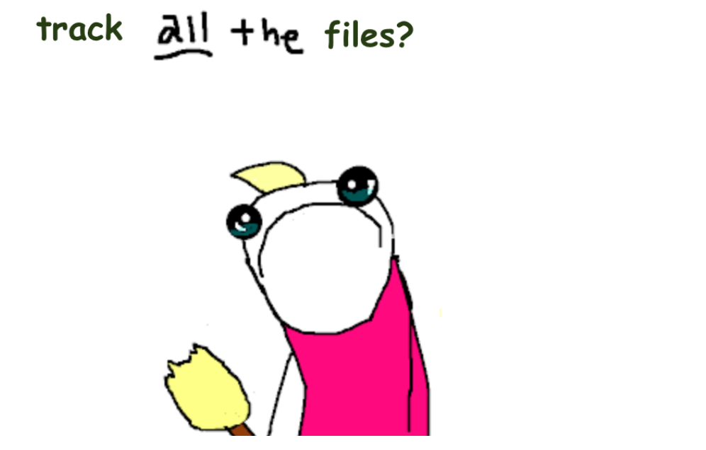

# .gitignore tutorial

Goals:

    <ul>
        <li> Understand what gitignore does </li>
        <li> Understand *why* gitignore is needed  </li>
        <li> Understand differences between a project-specific .gitignore, and global .gitignore </li>
        <li> Make your global gitignore </li>
        <li> Be aware of situations where you might need to add to your global .gitignore </li></ul>

 

When we say <code>git add .</code>, the <code>.</code> really means *everything.* Including the files you can't see. 

 

Letting git track all hidden files isn't a good idea. Some files aren't needed, and some are specific to your computer. Tracking changes for these will clutter up the git log.*  

In order to avoid tracking them, we need to use a .gitignore file. This does exactly what it sounds like: tells git what to ignore. Why not delete them instead? Many of them aren't possible to delete permanently. They will respawn. Sometimes they might be important to you or your computer. 

## Global gitignore vs. project-specific gitignore
The first place git looks for a .gitignore file is **in your repository**. You shouldn't encounter situations where you need to make a special gitignore for your repository, until you get into later projects and capstone work.

Next, git looks for a **global gitignore**. If there's no .gitignore file in your repository, git will use your global one. A global gitignore should live outside of any git repositories - usually, in your home directory. You'll want to include files from languages and apps you work with frequently across multiple projects, in order to avoid having to add a new .gitignore file to every project and lab you push. 

You'll encounter project-specific (and directory-specific) gitignores when working on a codebase. 
What if you also have a global gitignore? Both will be used! But, the local repository's gitignore will be the winner in the case of a <a href='https://stackoverflow.com/questions/29990627/ignore-a-global-gitignore-rule-for-specific-repository'>disagreement.</a>

## What goes in a .gitignore file?

- Program-specific files (usage logs, settings, cache files etc)
- OS-specific files 
- Extra files generated by the programming language you're using
- Folders generated by package managers
- Any files containing sensitive information

For a more detailed breakdown, check out <a href='https://git-scm.com/docs/gitignore'>git documentation</a>. The gitignore we provide for you today will be sufficient for labs and projects. If you run into issues in week 11, that's a great time to practice updating it!

Project-specific stuff should go in a project gitignore. Your global gitignore can contain files that you deal with all the time.

## Patterns
Lines in your .gitignore don't have to be entire filenames, they can be patterns. Git's pattern matching is similar to what you might see elsewhere, with a few exceptions. Take a look at <a href='https://git-scm.com/docs/gitignore'>git docs</a>, or <a href='https://pypi.org/project/pathspec/'>pathspec library</a> if you want to practice!

## Set up your global gitignore file

<h3>Mac</h3>
    <ol>
        <li>Open a terminal tab and navigate to your home directory (if you aren't already there.)</li> 
        <li>Run <code>touch .gitignore_global</code></li> 
        <li>Open the new .gitignore_global file with vim, nano, or a code editor of your choice</li> 
        <li>Copy and paste the following into the document:  
<pre>
<code>&#35; Folder view configuration files
.DS_Store
 
&#35; Thumbnail cache files
._*
 
&#35; VSCode
.vscode
 
&#35; IPython Notebook
*.ipynb_checkpoints</code>
</pre></li> 
        <li>Save and close it</li> 
        <li>Back in the terminal, run <code>git config --global core.excludesfile ~/.gitignore_global</code></li> 
        <li>Take a look at your .gitconfig file to make sure it's there. You can also check by running <code>git config --get core.excludesfile</code></li></ol>

 
    
<h3>Windows</h3>
    <ol>
        <li>Open a terminal tab and navigate to your home directory (if you aren't already there.)</li> 
        <li>Run <code>touch .gitignore_global</code></li> 
        <li>Open the new .gitignore_global file with vim, nano, or a code editor of your choice</li> 
        <li>Copy and paste the following into the document:  
        <pre><code>
&#35; Folder view configuration files
[Dd]esktop.ini
 
&#35; Thumbnail cache files
Thumbs.db
 
&#35; VSCode
.vscode
 
&#35; IPython Notebook
*.ipynb_checkpoints
</code></pre></li> 
        <li>Save and close it</li> 
        <li>Back in the terminal, run <code>git config --global core.excludesfile %USERPROFILE%\.gitignore_global</code></li> 
        <li>Take a look at your .gitconfig file to make sure it's there. You can also check by running <code>git config --get core.excludesfile</code></li></ol>

 

    
    
## Now what
You might forget about global .gitignore for a while, now that thumbs.db and jupyter checkpoints have been permanently sorted. Don't forget about it forever! If you start regularly using a new application, programming language, or OS, you may want to take a look at it.

Not everyone in industry uses global gitignore, but knowing that it's possible, how it works, and how to set them up will put you ahead of the curve when it comes to maintaining a codebase and working on a team.

## More resources
- <a href='https://git-scm.com/docs/gitignore'>Git documentation - best practices, pattern matching, gitignore triage</a>
- <a href='https://github.com/github/gitignore/blob/main/Python.gitignore'>Github's gitignore reccs for different programs and languages</a>
- <a href='https://docs.github.com/en/get-started/getting-started-with-git/ignoring-files'>Github's "ignoring files" guide</a>
- <a href='https://github.com/davvid/wildmatch#description'>Git style pattern matching history</a> 
- <a href='https://luisdalmolin.dev/blog/ignoring-files-in-git-without-gitignore/'>git/info/exclude vs. gitignore</a>
- <a href="https://www.freecodecamp.org/news/gitignore-file-how-to-ignore-files-and-folders-in-git/">"Help, I accidentally committed a hidden file and now I can't get it to go away, even after updating my gitignore file"</a>
- <a href="https://www.toptal.com/developers/gitignore">gitignore generator</a>
