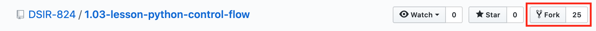
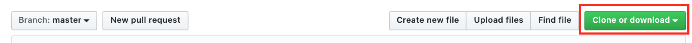
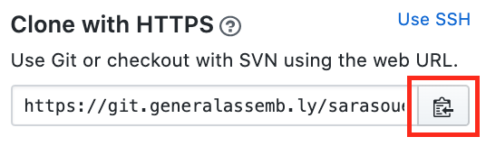

# Breakfast-Hour

## Git Workflows

**Lessons**<br>
_Lessons are pushed daily. You must fork and clone each lesson before the start of class._

| Location | Action                                                   | When                  | Why    |
|----------|----------------------------------------------------------|-----------------------|--------|
| **GHE** <br> DSB-521/lesson      |                   | before class | create your own lesson repo by forking |
| **GHE** <br> Your-name/lesson      |  | before class |first step into putting your repo on your local machine|
| **GHE** <br> Your-name/lesson       |  | before class| copies address to use in terminal to clone the repo|
| **Terminal** <br> class | ```git clone [Your-name/lesson address]``` | before class | clones your GHE repo to your local machine (adds new git repository to your machine) |
| **Terminal** <br> class | ```cd [lesson]``` | before class | move into your new repo |
| **Jupyter Lab**   | work in jupyter lab                                      | during class | |
| **Jupyter Lab**   | save and close in jupyter lab                            | after class  | saves your local work and shuts down kernel|
| **Terminal** <br> lesson/class    | ```git add . ``` <br> ```git commit -m "message"``` <br> ```git push``` | after class  | pushes your local changes to your origin repo on GHE|

------------

**Labs/Projects**<br>
_Typically, there are two labs per week. You must fork and clone each lab._

| Location | Action                                                   | When                  | Why    |
|----------|----------------------------------------------------------|-----------------------|--------|
| **GHE** <br> DSB-521/lab      |                   | before working on lab | create your own lab repo by forking |
| **GHE** <br> Your-name/lab      |  | before working on lab |first step into putting your repo on your local machine|
| **GHE** <br> Your-name/lab       |  | before working on lab| copies address to use in terminal to clone the repo|
| **Terminal** <br> class | ```git clone [Your-name/lab address]``` | before working on lab | clones your GHE repo to your local machine (adds new git repository to your machine) |
| **Terminal** <br> class | ```cd [lab]``` | before working on lab | move into your new repo |
| **Jupyter Lab**   | work in jupyter lab                                      | working on lab | |
| **Jupyter Lab**   | save and close in jupyter lab                            | after working on lab  | saves your local work and shuts down kernel|
| **Terminal** <br> lesson/class    | ```git add . ``` <br> ```git commit -m "message"``` <br> ```git push``` | after working on lab  | pushes your local changes to your origin repo on GHE|
| **Google Classroom** | submit your lab by adding the lab url as a link on Google Classroom | before lab is due |for grading|

------------

**Breakfast-Hour**<br>
_Breakfast-Hour is updated nightly by IAs. You must pull the repo every morning to maintain current version_

| Location | Action                                                   | When                  | Why    |
|----------|----------------------------------------------------------|-----------------------|--------|
| **Terminal** <br>Breakfast-Hour   | ```git pull upstream main```                         | before breakfast hour |get most current version of repo (updated by IAs) |
| **Jupyter Lab**    | **Make a copy of the notebook with your name!**     | before breakfast hour |copy starter-code.ipynb and assign new name|
| **Jupyter Lab**   | work in jupyter lab                                      | during breakfast hour  | |
| **Jupyter Lab**   | save and close in jupyter lab                            | after breakfast hour  | saves your local work and shuts down kernel|
| **Terminal** <br> Breakfast-Hour      | ```git add . ``` <br> ```git commit -m "message"``` <br> ```git push origin main``` | after breakfast hour  | pushes your local changes to your origin repo on GHE|

------------
